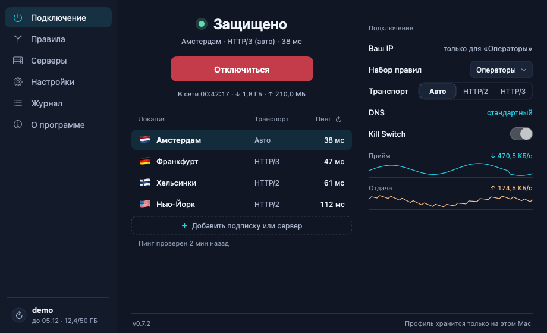
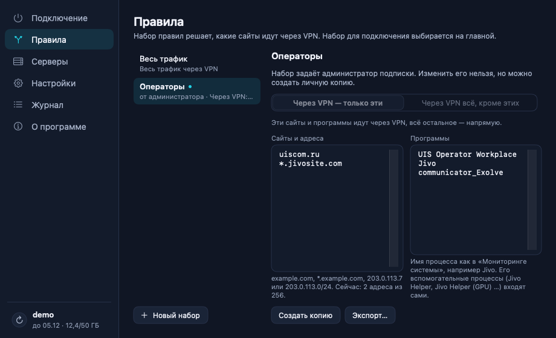

<p align="center"></p>

# Netlane для macOS

VPN-клиент на базе [TrustTunnel](https://github.com/TrustTunnel/TrustTunnelClient): подписки, наборы правил для сайтов и программ, Kill Switch. macOS 13+, одна сборка для Intel и Apple Silicon. Версия для Windows — [netlane-windows](https://github.com/divezh/netlane-windows).

<p align="center">
  
  
</p>

## Установка

Скачайте **[Netlane-macos.pkg](https://github.com/divezh/netlane-macos/releases/latest/download/Netlane-macos.pkg)** и откройте. Приложение не подписано Apple, поэтому при первом запуске: «Системные настройки» → «Конфиденциальность и безопасность» → «Всё равно открыть».

Или одной командой, без предупреждения macOS:

```sh
curl -fsSL https://raw.githubusercontent.com/divezh/netlane-macos/main/install.sh | sh
```

Затем «Добавить сервер» → вставьте ссылку подписки от администратора.

## Полезное

```sh
tail -f ~/Library/Logs/Netlane/engine.log          # журнал VPN
cat ~/Library/Logs/Netlane/update.log              # журнал обновлений
open ~/Library/Application\ Support/Netlane         # настройки и подписки (state.json)
sudo launchctl print system/io.github.divezh.netlane.helper | head   # помощник VPN

# удалить Netlane полностью
curl -fsSL https://raw.githubusercontent.com/divezh/netlane-macos/main/uninstall.sh | sh
```

Правило программы — имя процесса из «Мониторинга системы», например `Google Chrome`. Вспомогательные процессы (`Google Chrome Helper (GPU)` и т. п.) входят в правило сами. В панели правило пишется с `.exe` (`Google Chrome.exe`); на Windows у Chrome другое имя файла — `chrome.exe`, добавьте и его.

## Сборка

```sh
brew install cmake ninja      # и rustup для сборки движка
scripts/build-app.sh          # → dist/Netlane-macos.pkg и .zip
```

Релиз: поднять версию в `Sources/NetlaneCore/Support.swift` и CHANGELOG, опубликовать релиз `vX.Y.Z` — Actions соберёт его; установленные клиенты увидят его как обновление.

[MIT](LICENSE) · [сторонние компоненты](THIRD_PARTY_NOTICES.md) · об уязвимостях пишите приватно через [Security advisories](https://github.com/divezh/netlane-macos/security/advisories/new)
