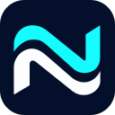

<p align="center"></p>

# Netlane для macOS

VPN-клиент для macOS 13 и новее (Apple Silicon и Intel) на базе [TrustTunnel](https://github.com/TrustTunnel/TrustTunnelClient). Подключается к вашему серверу по ссылке подписки. Те же возможности и тот же вид, что у [Netlane для Windows](https://github.com/divezh/netlane-windows) 0.7.0.

## Установка

1. Скачайте `Netlane-macos.zip` из [последнего релиза](https://github.com/divezh/netlane-macos/releases/latest) и распакуйте.
2. Перенесите `Netlane.app` в папку «Программы».
3. Первый запуск: приложение не подписано Apple Developer ID, поэтому macOS его остановит. Откройте «Системные настройки» → «Конфиденциальность и безопасность» и нажмите «Всё равно открыть» рядом с Netlane. То же самое одной командой:

   ```sh
   xattr -dr com.apple.quarantine /Applications/Netlane.app
   ```

4. Нажмите «Добавить сервер», вставьте ссылку подписки, затем «Подключиться».

При первом подключении Netlane один раз попросит пароль администратора, чтобы установить помощник (см. ниже). Дальше VPN включается без запросов.

Ссылку выдаёт администратор сервера. Серверная часть находится в [divezh/netlane](https://github.com/divezh/netlane).

## Возможности

- Транспорт HTTP/2 или HTTP/3, автоматический выбор, Anti-DPI, Kill Switch.
- Несколько серверов в одной подписке, проверка пинга, срок доступа и остаток трафика.
- Наборы правил для сайтов, IP и программ, собственные DNS; файлы правил `*.netlanerules` общие с Windows-клиентом.
- Значок в строке меню: подключение и смена локации без окна.
- Обновления внутри приложения с проверкой SHA-256.

## Маршрутизация по программам

В наборе правил можно указать программы: их соединения пойдут через VPN (или напрямую, в зависимости от режима набора). Имя — как в «Мониторинге системы», например `Jivo`. Вспомогательные процессы Electron- и Chromium-приложений (`Jivo Helper`, `Jivo Helper (GPU)`, `Jivo Helper (Renderer)`) и всё, что запускается изнутри `Jivo.app`, входят в правило сами — как несколько строк `PROCESS-NAME` в Clash.

Формат правил общий с панелью и Windows-клиентом: в панели программа записывается как `Jivo.exe`, на Mac это правило означает процесс `Jivo`. Один набор из панели работает на обеих системах. Правила с полным путём Windows (`C:\…\app.exe`) на Mac пропускаются.

Владельца соединения движок находит так же, как Clash: по сокету в ядре (libproc) определяется процесс, затем путь к его программе. Если владельца найти не удалось, соединение идёт через VPN.

## Помощник VPN

Создавать сетевой туннель и менять маршруты в macOS может только администратор. Чтобы не спрашивать пароль при каждом подключении, Netlane ставит небольшой помощник (`/Library/PrivilegedHelperTools/io.github.divezh.netlane.helper`, запускается через launchd). Что его ограничивает:

- к нему может обратиться только пользователь, который его установил;
- он принимает профиль, а не команду: профиль проходит те же проверки, что и в приложении, а конфигурацию движка помощник пишет сам;
- он запускает одну программу — движок, скопированный при установке в папку, доступную для записи только администратору.

Когда приложение закрывается, помощник останавливает VPN. Удалить помощник: «Настройки» → «Помощник VPN» → «Удалить».

## Безопасность

- Телеметрии нет. Приложение обращается только к вашим серверам и подпискам, к GitHub за обновлениями и к Cloudflare, чтобы показать внешний IP. Показ IP можно отключить в настройках.
- Профили и ссылки хранятся только на этом Mac: `~/Library/Application Support/Netlane/state.json`, доступ только у вашей учётной записи. Файл не зашифрован отдельно — его защищают права доступа и FileVault.
- Приложение подписано ad hoc, без Apple Developer ID. Происхождение архива можно проверить так:

  ```sh
  gh attestation verify Netlane-macos.zip --repo divezh/netlane-macos
  ```

## Удаление

1. «Настройки» → «Помощник VPN» → «Удалить».
2. Закройте Netlane (значок в строке меню → «Выход») и удалите `Netlane.app`.
3. Удалите `~/Library/Application Support/Netlane` и `~/Library/Logs/Netlane`.

## Сборка

Нужны macOS 13+ и Xcode или Command Line Tools:

```sh
scripts/build-app.sh
```

Скрипт запускает тесты, собирает универсальный `dist/Netlane.app`, подписывает его ad hoc и создаёт `dist/Netlane-macos.zip`. Если движка ещё нет в `engine/dist`, сначала собирается он (`engine/build-engine.sh`): TrustTunnel Client 1.1.11 из исходников с патчами из `engine/upstream`. Для этого нужны `brew install cmake ninja` и rustup. Первая сборка движка долгая: Conan собирает OpenSSL и другие зависимости.

Устройство проекта:

| Папка | Что в ней |
| --- | --- |
| `Sources/NetlaneCore` | Профили `tt://`, подписки, правила, DNS, конфигурация движка, канал обновлений. Только Foundation; тесты идут и на Linux (`swift test`). |
| `Sources/NetlaneHelper` | Помощник: запускает движок от имени администратора. |
| `Sources/Netlane` | Приложение на SwiftUI. |
| `engine` | Сборка движка и патчи к TrustTunnel: `0001` общий с Windows (правила программ, Kill Switch), `0002` — поиск процесса-владельца на macOS. |
| `scripts` | Сборка и установка помощника. |

## Релизы

Публикация релиза на GitHub с тегом `vX.Y.Z` запускает сборку в Actions. Тег должен совпадать с `AppInfo.version` (`Sources/NetlaneCore/Support.swift`). Workflow прикладывает к релизу архив, SHA-256 и аттестацию происхождения и обновляет канал обновлений в ветке `updates`.

## Лицензия

[MIT](LICENSE). Сторонние компоненты перечислены в [THIRD_PARTY_NOTICES.md](THIRD_PARTY_NOTICES.md).
